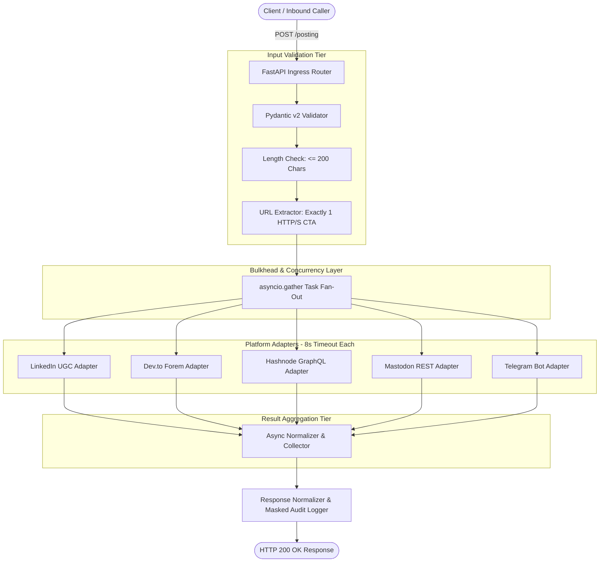

# Automated Multi-Platform Posting Service

> Asynchronous microservice built with **FastAPI** and **HTTPX** to concurrently publish content across multiple developer and social platforms (**LinkedIn**, **Dev.to**, **Hashnode**, **Mastodon**, and **Telegram**) with strict input validation, isolated bulkhead fault tolerance, and zero-leakage security governance.

[](https://www.python.org/)
[](https://fastapi.tiangolo.com/)
[](https://www.encode.io/httpx/)
[](https://pytest.org/)
[](LICENSE)

---

## Table of Contents

- [Overview](#overview)
- [System Architecture](#system-architecture)
- [Key Engineering Decisions](#key-engineering-decisions)
- [Supported Platforms](#supported-platforms)
- [API Specification](#api-specification)
  - [Ingress Endpoint](#ingress-endpoint)
  - [Request Validation Rules](#request-validation-rules)
  - [Example Request](#example-request)
  - [Example Response (Partial Success Scenario)](#example-response-partial-success-scenario)
- [Engineering Documentation](#engineering-documentation)
- [Local Setup & Development](#local-setup--development)
  - [Prerequisites](#prerequisites)
  - [Installation](#installation)
  - [Configuration](#configuration)
  - [Running the Server](#running-the-server)
  - [Running the Test Suite](#running-the-test-suite)
- [Docker Deployment](#docker-deployment)
- [Submission Metadata](#submission-metadata)

---

## Overview

The **Automated Multi-Platform Posting Service** exposes a single high-throughput REST endpoint:

```http
POST http://localhost:4000/posting
```

The service accepts a short promotional message (maximum 200 characters) containing exactly one Call-to-Action (CTA) link, validates input integrity, and broadcasts the content concurrently across 5 target platforms via non-blocking asynchronous I/O.

### Core Guarantees:
1. **Bulkhead Isolation:** A timeout, network partition, or authentication failure on one platform never blocks or degrades publishing to the remaining platforms.
2. **Deterministic Response Time:** Concurrent execution via `asyncio.gather` reduces total response latency from the sum of platform response times ($\sum t_i \approx 4.3\text{s}$) to the latency of the slowest platform ($\max(t_i) \approx 1.4\text{s}$).
3. **Zero-Leakage Logging:** API tokens, OAuth bearer tokens, and secrets are dynamically masked before any log records reach stdout or telemetry streams.
4. **RFC 7807 Compliance:** Validation failures return structured Problem Details envelopes with explicit diagnostic context.

---

## System Architecture



---

## Key Engineering Decisions

* **Non-Blocking I/O (`httpx.AsyncClient`):** Traditional synchronous HTTP libraries (`requests`, `urllib3`) block the Python event loop under high load. This service uses connection-pooled `httpx.AsyncClient` with keepalive, DNS caching, and explicit socket recycling ([ADR-002](docs/06-adr/ADR-002-async-http-client.md)).
* **Bulkhead Pattern (`return_exceptions=True`):** Unhandled platform exceptions are captured as exception objects rather than terminating the aggregate coroutine. The aggregator maps individual errors into a standardized `PlatformResult` model ([ADR-004](docs/06-adr/ADR-004-resilience-and-timeouts.md)).
* **Dual-Tier Timeout Budget:** Each adapter coroutine enforces an **8.0-second** SLA via `asyncio.wait_for`. This leaves a 2.0-second buffer before the global 10.0-second gateway timeout, guaranteeing deterministic error reporting ([ADR-004](docs/06-adr/ADR-004-resilience-and-timeouts.md)).
* **7-Stage Ingress Sanitization Pipeline:** Raw input undergoes automated BOM stripping, Unicode NFKC canonicalization, Trojan Source Bidi override rejection (CVE-2021-42574), zero-width character elimination, trailing punctuation stripping, and SSRF screening against loopback, private subnets, cloud metadata (`169.254.169.254`), and prohibited internal ports ([Sanitization Spec](docs/security/04-input-validation-and-sanitization-pipeline.md)).
* **URL Extraction & Normalization:** Employs RFC 3986-compliant regex parsing with trailing punctuation stripping (handles punctuation like `.,;:!?` adjacent to URLs) and rejects bare domains without explicit `http://` or `https://` schemes ([ADR-007](docs/06-adr/ADR-007-validation-error-model.md)).
* **Platform-Specific Format Adaptation:**
  * *Dev.to:* Synthesizes an article title from the first 60 characters and embeds the full text and CTA inside the markdown body.
  * *Hashnode:* Constructs an authenticated GraphQL mutation (`publishPost`) bound to the configured publication ID.
  * *LinkedIn:* Formulates a `w_member_social` UGC Share payload with `PUBLIC` visibility.
  * *Mastodon:* Publishes a status update to the instance configured via `MASTODON_BASE_URL`.
  * *Telegram:* Dispatches formatted text to the target channel via `sendMessage` using the bot secret token.

---

## Supported Platforms

| Platform | Channel Type | Protocol | Authentication Standard | Post URL Format | Public Visibility |
|---|---|---|---|---|:---:|
| **LinkedIn** | Professional Social | REST API | OAuth 2.0 Bearer Token | `https://www.linkedin.com/feed/update/urn:li:share:...` | Yes |
| **Dev.to** | Developer Community | REST API (Forem) | API Key (`api-key` header) | `https://dev.to/{username}/{slug}` | Yes |
| **Hashnode** | Developer Blogging | GraphQL API | Personal Access Token (`Authorization`) | `https://{blog}.hashnode.dev/{slug}` | Yes |
| **Mastodon** | Federated Social | REST API | OAuth 2.0 Bearer Token | `https://{instance}/@{user}/{status_id}` | Yes |
| **Telegram** | Instant Messaging | Bot REST API | Bot Secret Token (URL path) | `https://t.me/{channel}/{message_id}` | Yes |

---

## API Specification

### Ingress Endpoint

```http
POST /posting
Host: localhost:4000
Content-Type: application/json
Accept: application/json
```

### Request Validation Rules

| Rule | Constraint | Error Code | Description |
|---|---|---|---|
| **Character Budget** | $\le 200$ chars | `HTTP 422` | The combined message including the CTA URL cannot exceed 200 characters. |
| **CTA Link Count** | Exactly 1 URL | `HTTP 422` | The message must contain exactly one valid HTTP/HTTPS URL. Zero or $\ge 2$ URLs are rejected. |
| **Protocol Scheme** | `http://` or `https://` | `HTTP 422` | Protocols must be explicit; bare domains (e.g., `google.com`) or insecure schemas (`ftp://`) are rejected. |
| **Non-Empty Text** | 1 to 200 chars | `HTTP 422` | Empty strings or whitespace-only inputs are rejected. |
| **Sanitization & Normalization** | Unicode NFKC | `HTTP 422` | Strips BOM/zero-width chars (`\uFEFF`, `\u200B`), canonicalizes Unicode codepoints, collapses internal spaces. |
| **Trojan Source Defense** | No Bidi Override | `HTTP 422` | Bidirectional control chars (`\u202A`–`\u202E`) and null bytes (`\x00`) trigger immediate rejection (`ERR_MALICIOUS_CONTROL_CHARS`). |
| **SSRF Threat Screening** | Public FQDN Only | `HTTP 422` | Prohibits loopback (`127.0.0.1`, `localhost`), RFC 1918 private subnets, cloud metadata (`169.254.169.254`), and internal ports (`22, 25, 3306, 5432, 6379`). |

### Example Request

```bash
curl -X POST "http://localhost:4000/posting" \
  -H "Content-Type: application/json" \
  -d '{
    "message": "Accelerate multi-platform content distribution with our high-throughput automated posting service! https://techdeveloper.io"
  }'
```

### Example Response (Partial Success Scenario)

```json
{
  "success": true,
  "total_platforms": 5,
  "successful_posts": 4,
  "failed_posts": 1,
  "results": [
    {
      "platform": "LinkedIn",
      "status": "success",
      "posted_url": "https://www.linkedin.com/feed/update/urn:li:share:7123456789",
      "public_access": true,
      "date": "2026-11-18",
      "time": "12:30:15",
      "error": null
    },
    {
      "platform": "Dev.to",
      "status": "success",
      "posted_url": "https://dev.to/piyush/accelerate-multi-platform-content-distribution-abc123",
      "public_access": true,
      "date": "2026-11-18",
      "time": "12:30:16",
      "error": null
    },
    {
      "platform": "Hashnode",
      "status": "success",
      "posted_url": "https://piyush.hashnode.dev/accelerate-content-distribution",
      "public_access": true,
      "date": "2026-11-18",
      "time": "12:30:16",
      "error": null
    },
    {
      "platform": "Mastodon",
      "status": "success",
      "posted_url": "https://mastodon.social/@piyush/11234567890",
      "public_access": true,
      "date": "2026-11-18",
      "time": "12:30:17",
      "error": null
    },
    {
      "platform": "Telegram",
      "status": "failed",
      "posted_url": null,
      "public_access": false,
      "date": null,
      "time": null,
      "error": "Telegram Bot API error: Chat not found or Bot is not channel administrator"
    }
  ]
}
```

---

## Engineering Documentation

The repository includes a comprehensive, production-grade documentation suite:

| Discipline | Specification Files | Description |
|---|---|---|
| **Trade-Offs & FAQ** | [Architecture Trade-Offs & FAQ](docs/07-architecture-tradeoffs-and-faq.md) | Technical alternatives matrix (Why X over Y), integration challenges, and evaluator deep-dive FAQ |
| **Architecture** | [HLD](docs/02-hld.md) · [ADRs (8 Records)](docs/06-adr/) | High-Level Design, C4 diagrams, and 8 Architectural Decision Records |
| **Contracts** | [PRD](docs/01-prd.md) · [SRS](SRS.md) · [OpenAPI 3.1.0](openapi.yaml) | Functional/NFR requirements, IEEE 830 specification, OpenAPI schema |
| **Low-Level Design** | [Package & Code Blueprint](docs/lld/07-package-structure-and-code-blueprint.md) · [Class Design](docs/lld/01-class-and-object-design.md) · [Concurrency](docs/lld/04-concurrency-threading-model.md) · [Patterns & SOLID](docs/lld/05-design-patterns-and-solid-principles.md) · [Exception Hierarchy](docs/lld/06-exception-hierarchy-and-error-handling.md) | Master package taxonomy, Form/DTO separation, abstract adapters, GoF patterns (Adapter, Factory, Bulkhead, Strategy), SOLID matrix, DSA complexity, two-tier exception boundaries |
| **Security & SRE** | [Threat Model](docs/security/01-threat-model-stride.md) · [OWASP Audit](docs/security/02-owasp-api-top10-audit.md) · [Sanitization Pipeline](docs/security/04-input-validation-and-sanitization-pipeline.md) · [Telemetry](docs/observability/01-structured-logging-telemetry.md) | STRIDE analysis, OWASP API Top 10, 7-stage input sanitization, JSON structured logging |
| **Resilience** | [Bulkhead Pattern](docs/resilience/01-fault-tolerance-bulkhead.md) · [Timeouts](docs/resilience/02-timeout-and-retry-policy.md) · [Error Catalog](docs/resilience/03-error-catalogue-degradation.md) | Fault boundaries, dual-tier SLA timeouts, RFC 7807 error taxonomy |
| **Quality & QA** | [Test Strategy](docs/testing/01-test-strategy-and-pyramid.md) · [Test Catalog](docs/testing/02-test-cases-catalog.md) · [Performance](docs/testing/03-performance-load-testing.md) | Test pyramid, Triad test cases (Positive, Negative, Boundary), k6 benchmarks |
| **Modeling** | [Complete 13-Diagram UML Suite](uml/) | Structural (Class, Package, Component, Deployment) and Behavioral (Sequence, State, Activity) |
| **Operations** | [Container Spec](docs/devops/01-docker-and-container-spec.md) · [CI/CD Spec](docs/devops/02-ci-cd-pipeline-spec.md) · [Service DAG](docs/management/02-service-orchestration-dag.md) | OCI Dockerfile, GitHub Actions workflow, service orchestration DAG |

---

## Local Setup & Development

### Prerequisites

* **Python:** Version 3.10 or higher (Python 3.11 recommended)
* **Package Manager:** `pip` or `uv`
* **Git**

### Installation

```bash
# 1. Clone the repository
git clone https://github.com/piyushmakhija28/automated-posting.git
cd automated-posting

# 2. Create and activate a virtual environment
python -m venv venv
# On Windows:
venv\Scripts\activate
# On Linux/macOS:
source venv/bin/activate

# 3. Install dependencies
pip install -r requirements.txt
```

### Configuration

Create a `.env` file based on `.env.example`:

```bash
cp .env.example .env
```

Supply credentials for platforms you wish to test live against:

```ini
PORT=4000
ENVIRONMENT=development
LOG_LEVEL=INFO

# Platform API Credentials
LINKEDIN_ACCESS_TOKEN=your_linkedin_oauth_token
LINKEDIN_AUTHOR_URN=urn:li:person:your_person_id

DEVTO_API_KEY=your_devto_api_key

HASHNODE_ACCESS_TOKEN=your_hashnode_pat
HASHNODE_PUBLICATION_ID=your_publication_id

MASTODON_ACCESS_TOKEN=your_mastodon_bearer_token
MASTODON_BASE_URL=https://mastodon.social

TELEGRAM_BOT_TOKEN=your_telegram_bot_token
TELEGRAM_CHANNEL_ID=@your_channel_handle
```

> **Testing Mode:** If platform credentials are left empty or set to dummy tokens, the service safely captures authentication failures from the upstream APIs and reports them cleanly in the results array without terminating the server.

### Running the Server

Start the application with Uvicorn on port 4000:

```bash
uvicorn app.main:app --host 0.0.0.0 --port 4000 --reload
```

* **Interactive Swagger UI:** [http://localhost:4000/docs](http://localhost:4000/docs)
* **ReDoc Documentation:** [http://localhost:4000/redoc](http://localhost:4000/redoc)
* **Health Probe:** [http://localhost:4000/health](http://localhost:4000/health)

### Running the Test Suite

Execute the automated test suite with coverage enforcement ($\ge 90\%$):

```bash
# Run all unit, integration, and edge-case tests with coverage
pytest tests/ -v --cov=app --cov-report=term-missing --cov-fail-under=90

# Static type checking
mypy app/ --strict

# Linting and formatting checks
ruff check app/ tests/
black --check app/ tests/
```

---

## Docker Deployment

Build and run using the multi-stage, non-root Docker container:

```bash
# Build Docker image
docker build -t automated-posting:latest .

# Run container on port 4000
docker run -d --name automated-posting-svc \
  -p 4000:4000 \
  --env-file .env \
  automated-posting:latest

# Verify health
curl -f http://localhost:4000/health
```

---

## Submission Metadata

* **Candidate:** Piyush Makhija
* **Practical Test Assessment:** Dxora Technologies (Automated Multi-Platform Posting System)
* **Submission Deadline:** 22nd November 2026
* **Destination Email:** `hr@chivoxai.com`
* **GitHub Repository:** [piyushmakhija28/automated-posting](https://github.com/piyushmakhija28/automated-posting)
* **LinkedIn Profile:** [linkedin.com/in/piyush-makhija-a43618117](https://www.linkedin.com/in/piyush-makhija-a43618117/)
* **Portfolio & Other Projects:** [github.com/orgs/techdeveloper-org/repositories](https://github.com/orgs/techdeveloper-org/repositories)
