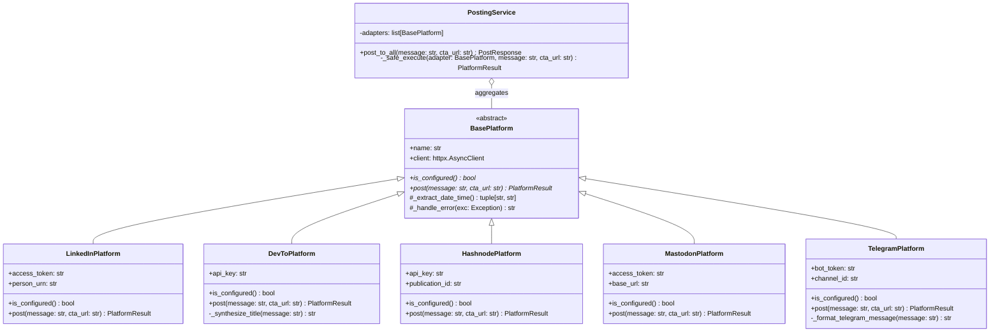

# Level 2: Low-Level Design (LLD) — Class & Object Modeling

**Document ID:** `DOC-LLD-01-CLASS-DESIGN`  
**Project:** `automated-posting`  
**Author:** Principal Software Architect
**Reviewer:** Staff Backend Engineering Lead
**Status:** APPROVED  
**Standard:** Clean Architecture, SOLID Principles, PEP-484 Type Hinting

---

## 1. Class Hierarchy & Architecture Overview

The system strictly adheres to the **Open/Closed Principle (OCP)** and **Dependency Inversion Principle (DIP)**. Adding support for a 6th platform in the future requires creating a single new adapter file inheriting from `BasePlatform` without modifying any existing service or router code.



---

## 2. Core Abstract Port: `BasePlatform`

Located in `app/platforms/base.py`:

```python
from abc import ABC, abstractmethod
from datetime import datetime
from typing import Optional
import httpx
from app.schemas import PlatformResult

class BasePlatform(ABC):
    """
    Abstract Port defining the contract for all third-party publishing adapters.
    Guarantees non-blocking async execution and standardized result envelopes.
    """
    def __init__(self, client: Optional[httpx.AsyncClient] = None) -> None:
        self.client = client or httpx.AsyncClient(timeout=8.0)

    @property
    @abstractmethod
    def name(self) -> str:
        """Returns the canonical human-readable platform name."""
        pass

    @abstractmethod
    def is_configured(self) -> bool:
        """Evaluates whether all required environment credentials exist."""
        pass

    @abstractmethod
    async def post(self, message: str, cta_url: str) -> PlatformResult:
        """
        Publishes the message and CTA link asynchronously.
        Must catch platform-specific exceptions and return a structured PlatformResult.
        """
        pass

    def _get_current_timestamp(self) -> tuple[str, str]:
        """Returns (YYYY-MM-DD, HH:MM:SS) in local time."""
        now = datetime.now()
        return now.strftime("%Y-%m-%d"), now.strftime("%H:%M:%S")
```

---

## 3. Data Models: Pydantic v2 Schemas

Located in `app/schemas.py`:

```python
from pydantic import BaseModel, Field, field_validator, ConfigDict
from typing import Optional, List
import re
from urllib.parse import urlparse

class PlatformResult(BaseModel):
    """Execution telemetry for a single target platform."""
    model_config = ConfigDict(frozen=True)

    platform: str = Field(..., description="Target platform name")
    status: str = Field(..., description="'success' or 'failed'")
    posted_url: Optional[str] = Field(None, description="Direct URL to published post if successful")
    public_access: bool = Field(False, description="Whether content is publicly accessible without login")
    date: Optional[str] = Field(None, description="Posting date (YYYY-MM-DD)")
    time: Optional[str] = Field(None, description="Posting time (HH:MM:SS)")
    error: Optional[str] = Field(None, description="Error diagnostics if failed")

class PostRequest(BaseModel):
    """Ingress request body for POST /posting."""
    model_config = ConfigDict(str_strip_whitespace=True)

    message: str = Field(
        ...,
        min_length=1,
        max_length=200,
        description="Broadcast message text (max 200 chars) containing exactly one CTA URL."
    )

    @field_validator("message")
    @classmethod
    def validate_content_and_url(cls, v: str) -> str:
        if len(v) > 200:
            raise ValueError(f"Message length ({len(v)} chars) exceeds maximum allowed limit of 200 characters.")
        
        # Regex extraction
        matches = re.findall(r"https?://[^\s]+", v)
        cleaned = [m.rstrip(".,;:!?)'") for m in matches]
        
        if len(cleaned) == 0:
            raise ValueError("Message must contain exactly one valid CTA URL (http:// or https://). None found.")
        if len(cleaned) > 1:
            raise ValueError(f"Message contains {len(cleaned)} URLs. Exactly one CTA URL is permitted.")
            
        parsed = urlparse(cleaned[0])
        if not parsed.scheme or not parsed.netloc or "." not in parsed.netloc:
            raise ValueError(f"Extracted CTA URL '{cleaned[0]}' is syntactically invalid.")
            
        return v

class PostResponse(BaseModel):
    """Unified telemetry response payload."""
    model_config = ConfigDict(frozen=True)

    success: bool
    total_platforms: int
    successful_posts: int
    failed_posts: int
    results: List[PlatformResult]
```

---

## 4. Domain Service: `PostingService`

Located in `app/services/posting_service.py`:

```python
import asyncio
from typing import List
from app.platforms.base import BasePlatform
from app.schemas import PostResponse, PlatformResult

class PostingService:
    """
    Core orchestrator responsible for parallel fan-out execution,
    timeout enforcement, and aggregation of platform results.
    """
    def __init__(self, adapters: List[BasePlatform]) -> None:
        self.adapters = adapters

    async def _safe_execute(self, adapter: BasePlatform, message: str, cta_url: str) -> PlatformResult:
        if not adapter.is_configured():
            return PlatformResult(
                platform=adapter.name,
                status="failed",
                posted_url=None,
                public_access=False,
                date=None,
                time=None,
                error="Platform credentials not configured in environment variables."
            )
        try:
            # Enforce 8.0s timeout per adapter (ISSUE-005)
            return await asyncio.wait_for(adapter.post(message, cta_url), timeout=8.0)
        except asyncio.TimeoutError:
            return PlatformResult(
                platform=adapter.name,
                status="failed",
                posted_url=None,
                public_access=False,
                date=None,
                time=None,
                error="Platform execution timed out after 8.0 seconds."
            )
        except Exception as exc:
            return PlatformResult(
                platform=adapter.name,
                status="failed",
                posted_url=None,
                public_access=False,
                date=None,
                time=None,
                error=f"Unexpected adapter failure: {str(exc)}"
            )

    async def post_to_all(self, message: str, cta_url: str) -> PostResponse:
        tasks = [self._safe_execute(adapter, message, cta_url) for adapter in self.adapters]
        results = await asyncio.gather(*tasks)

        successful_count = sum(1 for r in results if r.status == "success")
        failed_count = sum(1 for r in results if r.status == "failed")
        overall_success = successful_count > 0 or (successful_count == 0 and len(results) == 0)

        return PostResponse(
            success=overall_success,
            total_platforms=len(results),
            successful_posts=successful_count,
            failed_posts=failed_count,
            results=list(results)
        )
```
