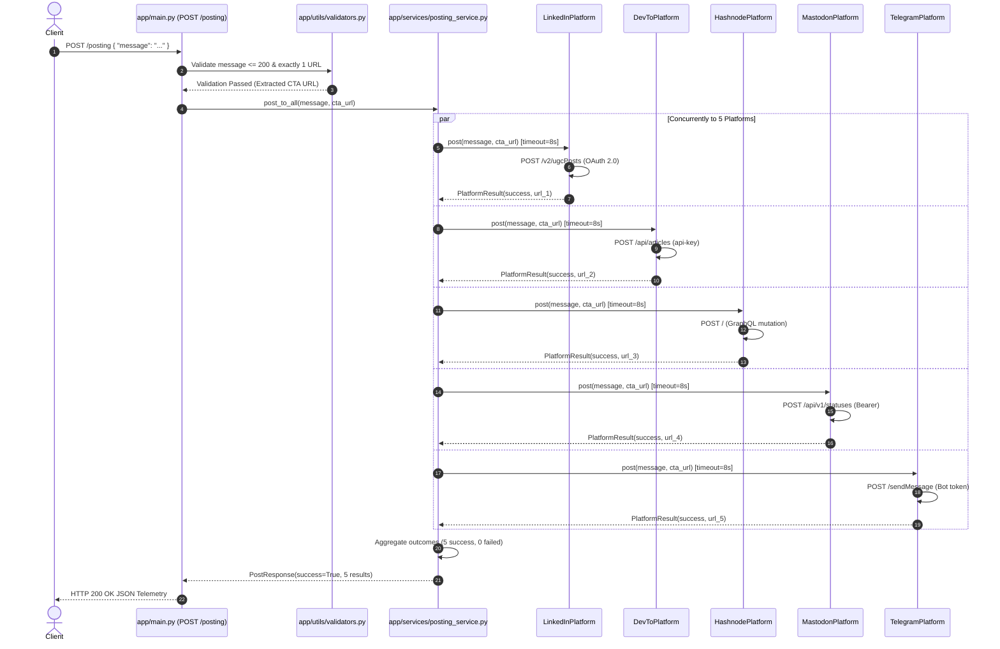
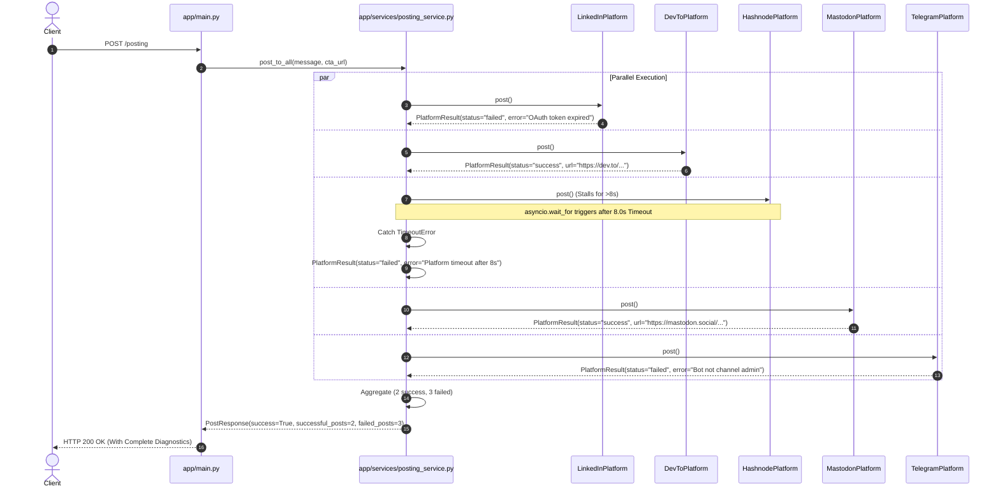
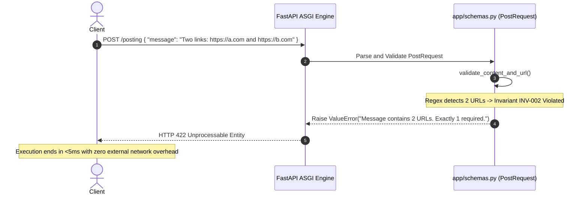
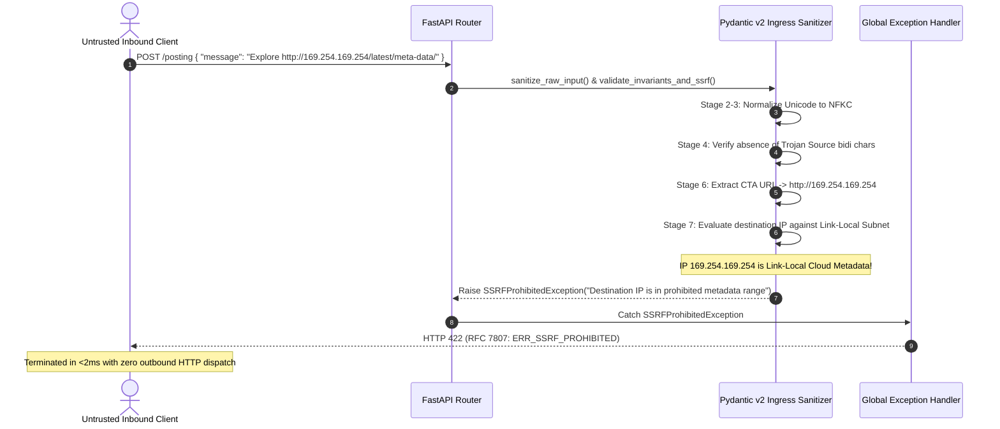

# Level 2: Low-Level Design (LLD) — Dynamic Interaction Sequences

**Document ID:** `DOC-LLD-02-SEQUENCES`  
**Project:** `automated-posting`  
**Author:** Principal Software Architect
**Reviewer:** Staff Backend Engineering Lead
**Status:** APPROVED  
**Standard:** UML 2.5 Sequence Specification

---

## 1. Sequence 1: Happy Path Concurrent Fan-Out

In the standard operational scenario, a client issues a valid JSON payload. The router extracts the CTA link, delegates execution to `PostingService`, which spawns 5 parallel coroutines via `asyncio.gather`. All 5 adapters return `status: "success"`.

---

## 2. Sequence 2: Partial Failure & Fault Isolation (Bulkhead Pattern)

Demonstrates how the engine isolates failures. In this scenario:
- **Dev.to** and **Mastodon** succeed.
- **LinkedIn** returns HTTP 401 (token expired).
- **Telegram** returns HTTP 400 (bot not admin).
- **Hashnode** hangs and times out at 8.0 seconds.
- The overall system remains resilient and returns HTTP 200 with itemized diagnoses.

---

## 3. Sequence 3: Ingress Validation Failure

Demonstrates immediate short-circuiting when input violates invariants (e.g. 2 CTA links submitted). Zero network traffic is dispatched to external platforms.

---

## 4. Sequence 4: Ingress SSRF & Trojan Source Sanitization Interception

Demonstrates how the 7-stage Ingress Sanitization pipeline intercepts malicious payloads (e.g. cloud metadata IP `http://169.254.169.254` or Trojan Source bidi override characters `\u202E`) and formats an RFC 7807 Problem Details response without invoking downstream adapters:

