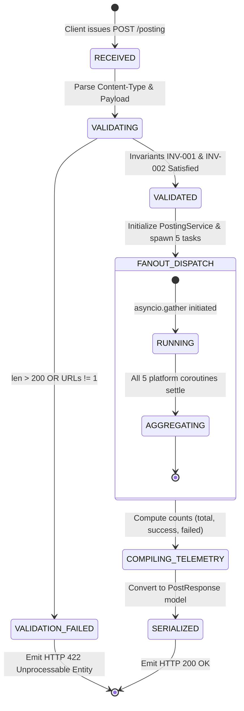
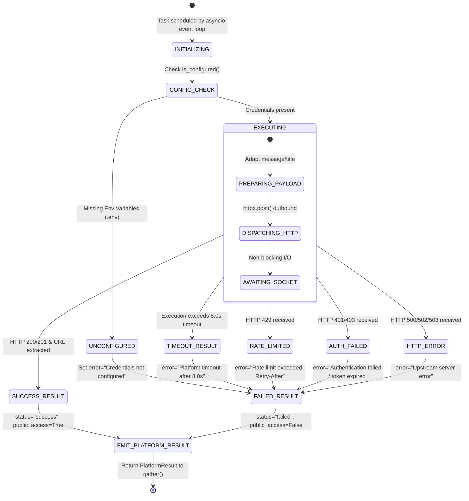

# Level 2: Low-Level Design (LLD) — State Machine & Request Lifecycle

**Document ID:** `DOC-LLD-03-STATE-MACHINE`  
**Project:** `automated-posting`  
**Author:** Principal Software Architect
**Reviewer:** Staff Backend Engineering Lead
**Status:** APPROVED  
**Standard:** UML 2.5 State Machine Specification

---

## 1. Request Processing State Machine

The overall lifecycle of an HTTP request traversing the system progresses through deterministic states:

---

## 2. Platform Adapter Execution State Machine

Each platform adapter coroutine operates within an isolated, deterministic execution lifecycle:

