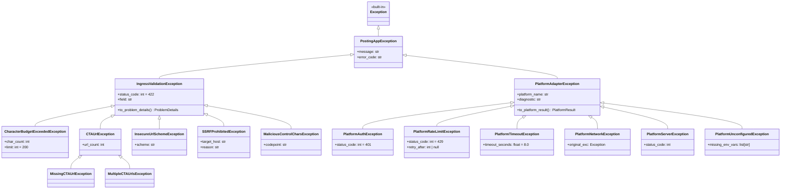

# Level 2.6: Low-Level Design — Domain Exception Hierarchy & Resilience Error Handling

**Document ID:** `DOC-LLD-06-EXCEPTION-HIERARCHY`  
**Project:** `automated-posting`  
**Author:** Principal Software Architect & Staff Backend Systems Engineer  
**Reviewer:** Technical Architecture Board  
**Approver:** Engineering Excellence Review Board
**Status:** APPROVED  
**Standard:** RFC 7807 (Problem Details for HTTP APIs), Python Exception Handling Best Practices, Clean Architecture Error Boundaries

---

## 1. Executive Summary

A core failure mode in poorly designed microservices is unhandled exception leakage — where an unexpected network error on a third-party platform causes an unhandled 500 Internal Server Error, dropping the entire transaction for all other platforms.

This document formalizes the **Two-Level Exception Boundary Model**:
1. **Level 1 (Ingress Domain Exceptions):** Exceptions raised during request decoding, JSON parsing, or Pydantic validation. These terminate the request immediately and are translated by global FastAPI exception handlers into structured **RFC 7807 Problem Details** envelopes (HTTP 400, 422, 429).
2. **Level 2 (Egress Platform Exceptions):** Exceptions raised during outbound network I/O to LinkedIn, Dev.to, Hashnode, Mastodon, or Telegram. These are **strictly trapped at the adapter boundary**, converted into a standardized `PlatformResult(status="failed", error=...)`, and never allowed to propagate upward or interrupt peer adapter coroutines.

---

## 2. Complete Domain Exception Hierarchy



---

## 3. Level 1: Ingress Exception Handlers & RFC 7807 Mapping

Ingress exceptions are caught by dedicated FastAPI exception handlers registered in `app/main.py` and mapped to RFC 7807 Problem Details schemas:

```python
"""Global exception handler registration blueprint."""

from fastapi import FastAPI, Request
from fastapi.responses import JSONResponse
from app.exceptions import IngressValidationException, PostingAppException


def register_exception_handlers(app: FastAPI) -> None:
    """Configures centralized RFC 7807 exception interception."""

    @app.exception_handler(IngressValidationException)
    async def handle_ingress_validation(
        request: Request, exc: IngressValidationException
    ) -> JSONResponse:
        """Translates domain validation errors into RFC 7807 envelopes."""
        correlation_id = request.headers.get("X-Request-ID", "unknown")
        payload = {
            "type": f"https://dxora.com/errors/{exc.error_code.lower()}",
            "title": exc.title,
            "status": exc.status_code,
            "detail": exc.message,
            "instance": str(request.url.path),
            "code": exc.error_code,
            "invalid_params": [
                {"name": exc.field, "reason": exc.message}
            ] if exc.field else []
        }
        return JSONResponse(
            status_code=exc.status_code,
            content=payload,
            headers={
                "Content-Type": "application/problem+json",
                "X-Request-ID": correlation_id
            }
        )

    @app.exception_handler(Exception)
    async def handle_uncaught_system_exception(
        request: Request, exc: Exception
    ) -> JSONResponse:
        """Failsafe handler for unhandled runtime exceptions (RFC 7807 HTTP 500)."""
        correlation_id = request.headers.get("X-Request-ID", "unknown")
        payload = {
            "type": "https://dxora.com/errors/internal-server-error",
            "title": "Internal Server Error",
            "status": 500,
            "detail": "An unhandled system exception occurred during request execution.",
            "instance": str(request.url.path),
            "code": "ERR_INTERNAL_SERVER",
            "invalid_params": []
        }
        return JSONResponse(
            status_code=500,
            content=payload,
            headers={
                "Content-Type": "application/problem+json",
                "X-Request-ID": correlation_id
            }
        )
```

---

## 4. Level 2: Egress Adapter Error Trapping & Normalization

To enforce the Bulkhead Pattern, every adapter executes outbound network operations inside a strict defensive wrapper. Under no circumstances does a platform adapter allow a network exception to bubble out of `post()`:

```python
"""Base adapter error handling pattern."""

import asyncio
from datetime import datetime
import httpx
from app.schemas import PlatformResult
from app.exceptions import (
    PlatformAuthException,
    PlatformRateLimitException,
    PlatformTimeoutException,
    PlatformNetworkException,
    PlatformServerException,
)


class BasePlatformAdapter:
    """Base class providing deterministic exception normalization."""

    def _normalize_exception(self, exc: Exception) -> str:
        """Translates raw HTTP / OS exceptions into clean diagnostic strings."""
        if isinstance(exc, asyncio.TimeoutError):
            return f"Platform SLA timeout: {self.name} failed to respond within 8.0s"

        if isinstance(exc, httpx.HTTPStatusError):
            status = exc.response.status_code
            if status == 401 or status == 403:
                return f"{self.name} API error: Authentication failed or access token expired (HTTP {status})"
            if status == 429:
                retry_after = exc.response.headers.get("Retry-After", "unknown")
                return f"{self.name} API error: Rate limit exceeded (HTTP 429). Retry after {retry_after}s"
            if status >= 500:
                return f"{self.name} API error: Upstream platform server error (HTTP {status})"
            return f"{self.name} API error: Upstream rejected request with HTTP {status}"

        if isinstance(exc, (httpx.ConnectError, httpx.NetworkError)):
            return f"{self.name} network error: Unable to establish connection to upstream server"

        return f"{self.name} unexpected error: {str(exc)}"

    def _create_failure_result(self, error_message: str) -> PlatformResult:
        """Constructs an RFC-compliant failed PlatformResult with UTC timestamps."""
        now = datetime.now()
        return PlatformResult(
            platform=self.name,
            status="failed",
            posted_url=None,
            public_access=False,
            date=None,
            time=None,
            error=error_message
        )
```

---

## 5. Exhaustive Error Code & Degradation Taxonomy

| Exception Class | Trigger Condition | Interception Layer | Final HTTP Status | Emitted Outcome |
|:---|:---|:---:|:---:|:---|
| `CharacterBudgetExceededException` | Message length $>200$ unicode chars | Pydantic validator | `HTTP 422` | RFC 7807 `ERR_CHAR_LIMIT_EXCEEDED` |
| `MissingCTAUrlException` | 0 URLs detected in message | Pydantic validator | `HTTP 422` | RFC 7807 `ERR_MISSING_CTA_URL` |
| `MultipleCTAUrlsException` | $\ge 2$ URLs detected in message | Pydantic validator | `HTTP 422` | RFC 7807 `ERR_MULTIPLE_CTA_URLS` |
| `InsecureUrlSchemeException` | URL has scheme other than `http`/`https` | Pydantic validator | `HTTP 422` | RFC 7807 `ERR_INVALID_URL_SCHEME` |
| `SSRFProhibitedException` | URL targets loopback, RFC 1918, or metadata IP | Pydantic validator | `HTTP 422` | RFC 7807 `ERR_SSRF_PROHIBITED` |
| `MaliciousControlCharsException`| Message contains bidi override (`\u202E`) | Pydantic validator | `HTTP 422` | RFC 7807 `ERR_MALICIOUS_CONTROL_CHARS` |
| `PlatformAuthException` | Upstream returns 401 or 403 | Adapter Bulkhead | `HTTP 200` | `PlatformResult.status="failed"`, `error="...Auth failed (HTTP 401)"` |
| `PlatformRateLimitException` | Upstream returns 429 Too Many Requests | Adapter Bulkhead | `HTTP 200` | `PlatformResult.status="failed"`, `error="...Rate limit (HTTP 429)"` |
| `PlatformTimeoutException` | Adapter coroutine exceeds 8.0s timeout | Adapter Bulkhead | `HTTP 200` | `PlatformResult.status="failed"`, `error="...SLA timeout after 8.0s"` |
| `PlatformNetworkException` | DNS lookup fails, TCP connection refused | Adapter Bulkhead | `HTTP 200` | `PlatformResult.status="failed"`, `error="...Unable to connect"` |
| `PlatformServerException` | Upstream platform crashes (HTTP 500, 502, 503)| Adapter Bulkhead | `HTTP 200` | `PlatformResult.status="failed"`, `error="...Upstream error (HTTP 5xx)"` |
| `PlatformUnconfiguredException` | Credentials missing in `.env` | Adapter Bulkhead | `HTTP 200` | `PlatformResult.status="failed"`, `error="...Credentials not configured"` |
