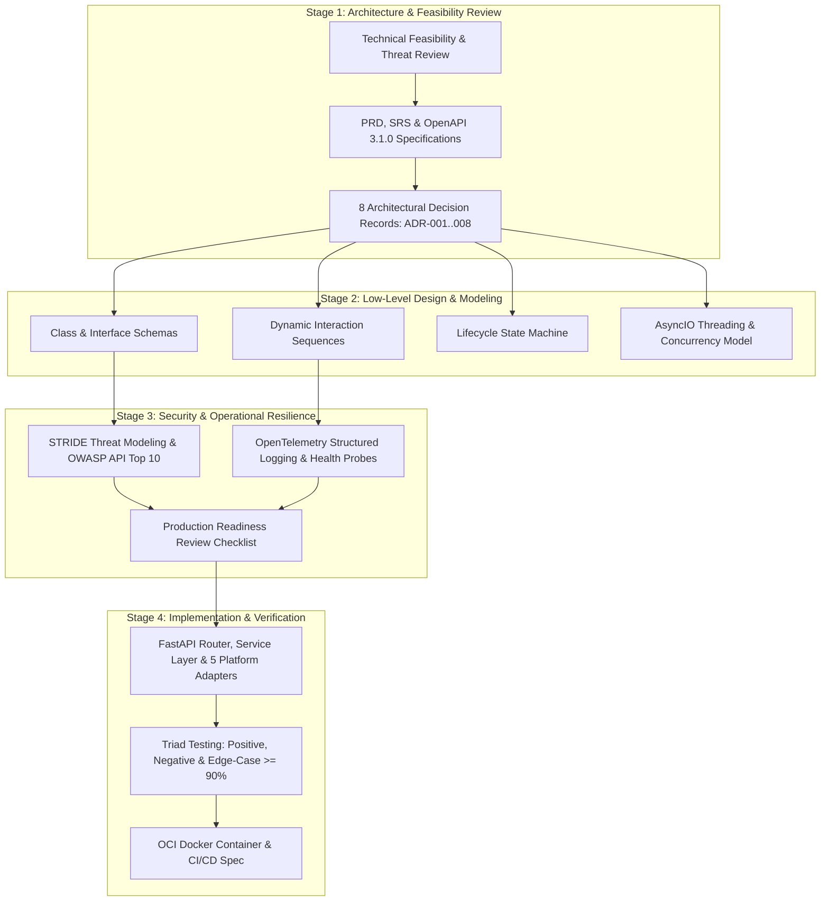

# Level 9: Engineering Governance & Architecture — Service Orchestration & Pipeline Execution DAG

**Document ID:** `DOC-MGT-02-SERVICE-DAG`  
**Project:** `automated-posting`  
**Author:** Principal Systems Architect  
**Reviewer:** Staff Backend Engineering Lead  
**Approver:** Technical Architecture Board  
**Status:** APPROVED  
**Standard:** Directed Acyclic Graph (DAG) Execution Pipeline & SDLC Quality Gates

---

## 1. Runtime Service Execution DAG

The diagram below details the Directed Acyclic Graph (DAG) for processing inbound posting requests, enforcing strict concurrency boundaries, fault isolation, and standardized response schemas:

```mermaid
graph TD
    subgraph Ingestion [Stage 1: Ingestion & Validation]
        ClientReq[HTTP Inbound POST /posting] --> AuthN[FastAPI Middleware / Router]
        AuthN --> SchemaVal[Pydantic v2 PostingRequest Validator]
        SchemaVal --> CharBudget[Budget Validator: <= 200 Chars]
        CharBudget --> URLVal[URL Extractor: Exactly 1 RFC-Compliant HTTP/S URL]
    end

    subgraph Dispatch [Stage 2: Bulkhead & Concurrent Fan-Out]
        URLVal --> TaskGen[Task Generator: Instantiate 5 Platform Dispatchers]
        TaskGen --> FanOut[asyncio.gather / TaskGroup Bulkhead]
    end

    subgraph Execution [Stage 3: Parallel Platform Adapters]
        FanOut --> AdpLI[LinkedIn Adapter: OAuth 2.0 UGC API (8s SLA)]
        FanOut --> AdpDV[Dev.to Adapter: Forem Articles API (8s SLA)]
        FanOut --> AdpHN[Hashnode Adapter: GraphQL API (8s SLA)]
        FanOut --> AdpMS[Mastodon Adapter: REST Status API (8s SLA)]
        FanOut --> AdpTG[Telegram Adapter: Bot SendMessage API (8s SLA)]
    end

    subgraph Aggregation [Stage 4: Normalization & Aggregation]
        AdpLI --> NormLI[Normalize PlatformResult]
        AdpDV --> NormDV[Normalize PlatformResult]
        AdpHN --> NormHN[Normalize PlatformResult]
        AdpMS --> NormMS[Normalize PlatformResult]
        AdpTG --> NormTG[Normalize PlatformResult]
        
        NormLI --> Collector[Async Collector / Tuple Unpacker]
        NormDV --> Collector
        NormHN --> Collector
        NormMS --> Collector
        NormTG --> Collector
    end

    subgraph Telemetry [Stage 5: Response Serialization & Telemetry]
        Collector --> RespModel[PostingResponse: success=true/false, results]
        RespModel --> AuditLog[Structured JSON Logging: Masked Credentials]
        AuditLog --> ClientResp[HTTP 200 OK / Problem Details]
    end
```

---

## 2. SDLC Engineering Governance DAG

The delivery lifecycle follows a structured sequential and parallel pipeline across engineering disciplines:



---

## 3. Engineering Quality Gates & Exit Criteria

1. **Gate 1 (Specifications to Architecture):** Formal sign-off on PRD, SRS, OpenAPI contracts, and all 8 Architectural Decision Records.
2. **Gate 2 (Design to Security & Resilience):** STRIDE threat assessment, OWASP API Top 10 mitigation validation, and SRE logging governance approved.
3. **Gate 3 (Implementation to Verification):** Complete decoupling of adapters via abstract base classes; zero shared mutable state.
4. **Gate 4 (Release Readiness):** Triad test suite execution achieves $\ge 90\%$ line coverage with full mock isolation and no external network dependencies during automated runs.
