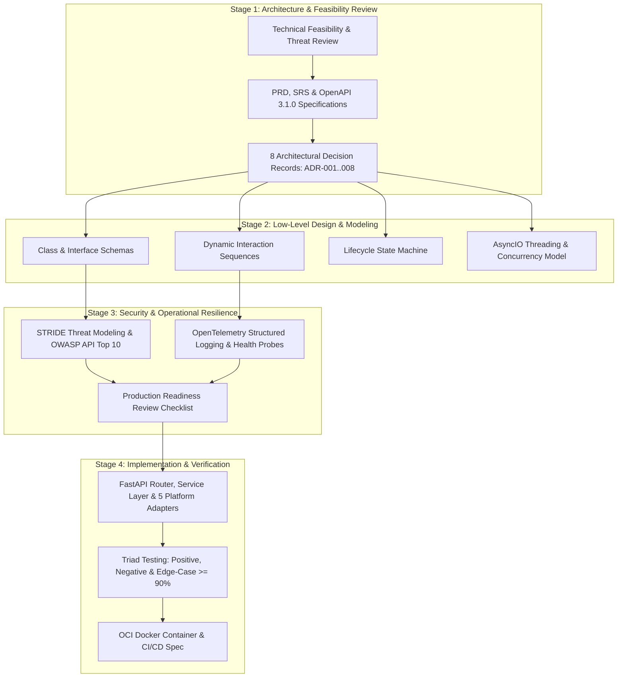
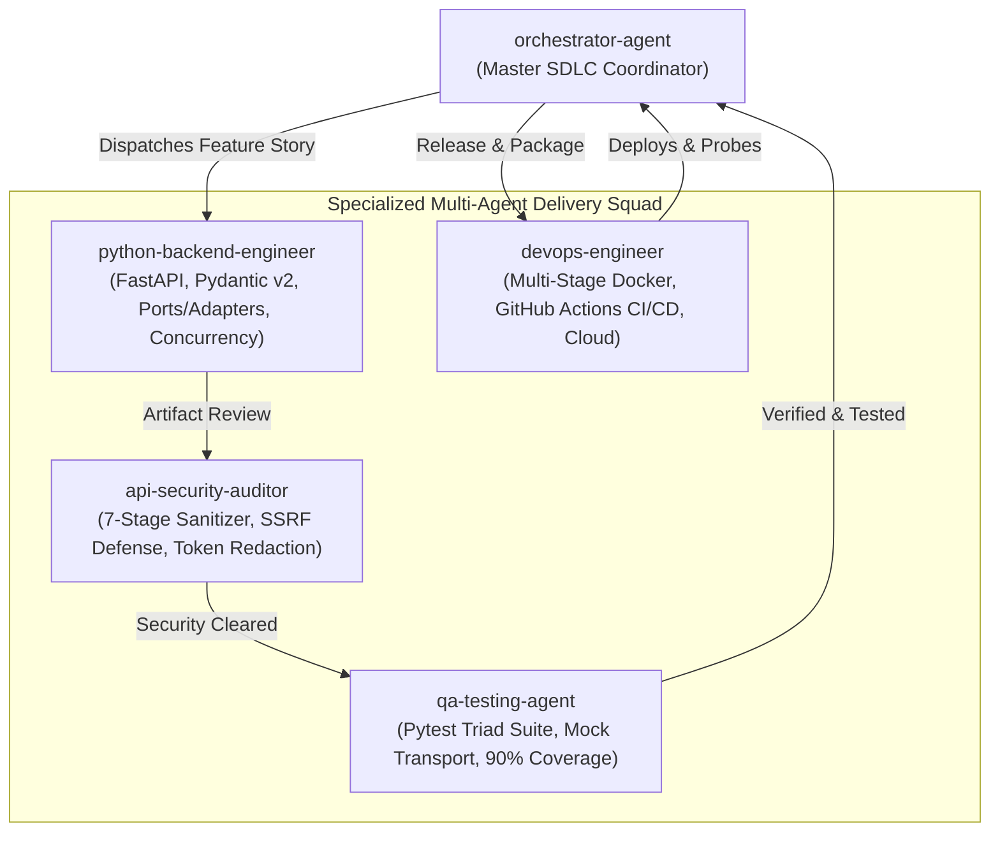

# Level 9: Engineering Governance & Architecture — Service Orchestration & Pipeline Execution DAG

**Document ID:** `DOC-MGT-02-SERVICE-DAG`  
**Project:** `automated-posting`  
**Author:** Principal Systems Architect  
**Reviewer:** Staff Backend Engineering Lead  
**Approver:** Technical Architecture Board  
**Status:** APPROVED  
**Standard:** Directed Acyclic Graph (DAG) Execution Pipeline & SDLC Quality Gates

---

## 1. Runtime Service Execution DAG

The diagram below details the Directed Acyclic Graph (DAG) for processing inbound posting requests, enforcing strict concurrency boundaries, fault isolation, and standardized response schemas:

```mermaid
graph TD
    subgraph Ingestion [Stage 1: Ingestion & Validation]
        ClientReq[HTTP Inbound POST /posting] --> AuthN[FastAPI Middleware / Router]
        AuthN --> SchemaVal[Pydantic v2 PostingRequest Validator]
        SchemaVal --> CharBudget[Budget Validator: <= 200 Chars]
        CharBudget --> URLVal[URL Extractor: Exactly 1 RFC-Compliant HTTP/S URL]
    end

    subgraph Dispatch [Stage 2: Bulkhead & Concurrent Fan-Out]
        URLVal --> TaskGen[Task Generator: Instantiate 5 Platform Dispatchers]
        TaskGen --> FanOut[asyncio.gather / TaskGroup Bulkhead]
    end

    subgraph Execution [Stage 3: Parallel Platform Adapters]
        FanOut --> AdpLI[LinkedIn Adapter: OAuth 2.0 UGC API (8s SLA)]
        FanOut --> AdpDV[Dev.to Adapter: Forem Articles API (8s SLA)]
        FanOut --> AdpHN[Hashnode Adapter: GraphQL API (8s SLA)]
        FanOut --> AdpMS[Mastodon Adapter: REST Status API (8s SLA)]
        FanOut --> AdpTG[Telegram Adapter: Bot SendMessage API (8s SLA)]
    end

    subgraph Aggregation [Stage 4: Normalization & Aggregation]
        AdpLI --> NormLI[Normalize PlatformResult]
        AdpDV --> NormDV[Normalize PlatformResult]
        AdpHN --> NormHN[Normalize PlatformResult]
        AdpMS --> NormMS[Normalize PlatformResult]
        AdpTG --> NormTG[Normalize PlatformResult]
        
        NormLI --> Collector[Async Collector / Tuple Unpacker]
        NormDV --> Collector
        NormHN --> Collector
        NormMS --> Collector
        NormTG --> Collector
    end

    subgraph Telemetry [Stage 5: Response Serialization & Telemetry]
        Collector --> RespModel[PostingResponse: success=true/false, results]
        RespModel --> AuditLog[Structured JSON Logging: Masked Credentials]
        AuditLog --> ClientResp[HTTP 200 OK / Problem Details]
    end
```

---

## 2. SDLC Engineering Governance DAG

The delivery lifecycle follows a structured sequential and parallel pipeline across engineering disciplines:



---

## 3. Engineering Quality Gates & Exit Criteria

1. **Gate 1 (Specifications to Architecture):** Formal sign-off on PRD, SRS, OpenAPI contracts, and all 8 Architectural Decision Records.
2. **Gate 2 (Design to Security & Resilience):** STRIDE threat assessment, OWASP API Top 10 mitigation validation, and SRE logging governance approved.
3. **Gate 3 (Implementation to Verification):** Complete decoupling of adapters via abstract base classes; zero shared mutable state.
4. **Gate 4 (Release Readiness):** Triad test suite execution achieves $\ge 90\%$ line coverage with full mock isolation and no external network dependencies during automated runs.

---

## 4. Multi-Agent Orchestration Framework & Squad Governance

The implementation phase is orchestrated as a **Multi-Agent Directed Acyclic Graph (DAG)** rooted in the **LangGraph Supervisor Pattern** (`claude-workflow-engine` SDLC framework). Rather than relying on a single generalist model, execution is delegated across specialized engineering agents from the **Claude Global Library**:



### Squad Roster & Roles

| Agent Name | Global Library Path | Core Discipline & Responsibility | Assigned Sprint Scope |
|:---|:---|:---|:---|
| **`orchestrator-agent`** | `agents/orchestrator-agent/` | **Squad Lead & State Manager:** Manages DAG transitions, sprint milestone boundaries, GitHub issue tracking, and quality gate evaluations. | Sprints 1 – 5 |
| **`python-backend-engineer`** | `agents/python-backend-engineer/` | **Core Backend Specialist:** Implements Pydantic v2 forms, immutable DTOs, `BasePlatformAdapter`, `AdapterRegistry`, 5 concrete platform adapters, `PostingServiceImpl` bulkhead concurrency, and FastAPI ingress routers. | Sprints 1, 2, 3, 4 |
| **`api-security-auditor`** | `agents/api-security-auditor/` | **Security & Hardening Lead:** Governs the 7-stage input sanitization engine, Trojan Source Bidi detection, SSRF filtering against private CIDRs, and `SensitiveDataFilter` secret masking in JSON telemetry. | Sprints 1, 2 |
| **`qa-testing-agent`** | `agents/qa-testing-agent/` | **Quality Assurance Lead:** Designs and executes the 11-layer Triad automated test suite (`tests/test_*.py`), in-memory mock transports, and enforces the $\ge 90\%$ statement/branch coverage gate. | Sprints 1, 2, 3, 4 |
| **`devops-engineer`** | `agents/devops-engineer/` | **Infrastructure & SRE Lead:** Authors the multi-stage non-root OCI Dockerfile, GitHub Actions CI/CD workflows, and conducts deployment smoke tests. | Sprint 5 |

### Multi-Agent Execution Protocol

For every sprint user story:
1. **Dispatch:** `orchestrator-agent` activates `python-backend-engineer` with exact acceptance criteria from the GitHub issue.
2. **Build:** `python-backend-engineer` implements target files following Level 2.2 Docstrings-Only convention and clean architecture.
3. **Security Gate:** `api-security-auditor` reviews code for secret leakage, regex denial of service (ReDoS), and SSRF vulnerabilities.
4. **Verification Gate:** `qa-testing-agent` writes and executes pytest Triad suites. If test coverage is $< 90\%$ or any test fails, control loops back to the builder for remediation.
5. **Commit & Close:** Upon passing all gates, `orchestrator-agent` commits changes referencing the issue number (`feat: ... (#N)`) and closes the GitHub issue.
