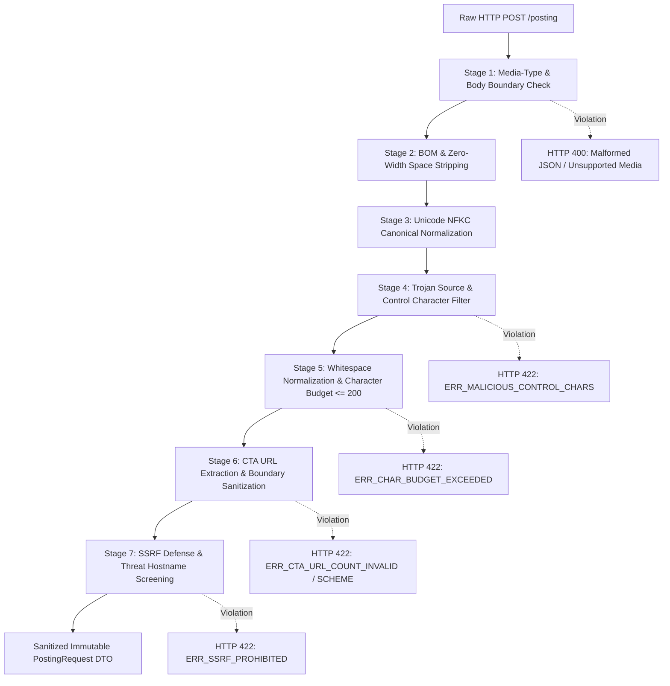

# Level 3.4: Ingress Request Validation, Normalization & Security Sanitization Pipeline

**Document ID:** `DOC-SEC-04-INPUT-SANITIZATION`  
**Project:** `automated-posting`  
**Author:** Principal Security Architect & Staff Backend Systems Engineer  
**Reviewer:** Cyber Governance & Risk Review Board  
**Approver:** Technical Architecture Board  
**Status:** APPROVED  
**Standard:** OWASP Input Validation Cheat Sheet, OWASP ASVS v4.0 (Section V5), RFC 3986 (URI Generic Syntax)

---

## 1. Executive Summary

In a high-throughput, multi-platform content publishing engine, inbound user input passes directly from an external untrusted network to upstream third-party APIs (LinkedIn, Dev.to, Hashnode, Mastodon, Telegram). Without a rigorous, multi-stage **Validation, Normalization, and Sanitization Pipeline**, the application is vulnerable to:
* **Trojan Source & Bidirectional Text Injection** (visual spoofing via Unicode bidi override characters).
* **Server-Side Request Forgery (SSRF) & Metadata Scraping** (attempts to broadcast internal AWS/GCP metadata endpoints `169.254.169.254` or loopback `localhost`).
* **Hidden Payloads & Zero-Width Steganography** (zero-width spaces masking exploit payloads or circumventing the 200-character budget).
* **Cross-Site Scripting (XSS) & Markdown Exploits** on downstream platforms (Dev.to and Hashnode render Markdown/HTML).
* **Punctuation & Delimiter Glitches** causing malformed URLs during third-party dispatch.

This document formalizes the **7-Stage Ingress Sanitization Engine** embedded inside the Pydantic v2 model layer.

---

## 2. Ingress Pipeline Architecture



---

## 3. The 7-Stage Sanitization Engine Specification

### Stage 1: Media-Type & Content-Type Gate
* **Requirement:** Inbound payload must specify `Content-Type: application/json` (or `application/json; charset=utf-8`).
* **Enforcement:** Ingress middleware verifies content-type headers. Unsupported media types (e.g. `multipart/form-data`, `application/xml`) or raw malformed strings immediately trigger `HTTP 415 Unsupported Media Type` or `HTTP 400 Bad Request` before invoking Pydantic deserializers.

### Stage 2: Byte-Order Mark (BOM) & Zero-Width Character Stripping
* **Threat:** Attackers utilize invisible Unicode characters to artificially deflate visual character count while injecting hidden tracking tokens or exploiting parsing differences.
* **Neutralization:** The engine scans and unconditionally strips:
  * UTF-8 Byte Order Mark: `\uFEFF`
  * Zero-Width Space: `\u200B`
  * Zero-Width Non-Joiner: `\u200C`
  * Zero-Width Joiner: `\u200D`
  * Word Joiner / Invisible Separator: `\u2060`, `\u180E`

### Stage 3: Unicode Canonical Compatibility Normalization (NFKC)
* **Threat:** Unicode homoglyphs and composite characters can represent the same visual glyph using multiple distinct codepoints, leading to character counting bypasses or downstream rendering anomalies.
* **Neutralization:** All inbound string content is processed through Python's standard `unicodedata.normalize('NFKC', text)`. This converts compatibility characters into their canonical equivalents and ensures deterministic codepoint accounting.

### Stage 4: Trojan Source & Control Character Neutralization
* **Threat (CVE-2021-42574):** Bidirectional override characters (`\u202A` through `\u202E`, `\u2066` through `\u2069`) can visually reorder text, tricking users into clicking one link while displaying another.
* **Neutralization:**
  1. Any message containing bidirectional override or embedding characters is **strictly rejected** with `HTTP 422 Unprocessable Entity` and error code `ERR_MALICIOUS_CONTROL_CHARS`.
  2. ASCII control characters (`\x00` through `\x1F` and `\x7F`), excluding standard safe whitespace (`\n`, `\r`, `\t`), are stripped or rejected. Null bytes (`\x00`) trigger immediate rejection.

### Stage 5: Whitespace Normalization & Character Budget Enforcement
* **Rule:** $1 \le \text{len}(\text{message}) \le 200$.
* **Sanitization:**
  1. Leading and trailing whitespace is trimmed (`strip()`).
  2. Consecutive internal whitespace (multiple tabs or spaces) is collapsed to single spaces to prevent downstream layout corruption.
  3. Strict length check is executed on the normalized string: $\text{len}(\text{cleaned\_text}) \le 200$.
  4. Empty strings (`""`) or strings consisting solely of whitespace trigger `ERR_EMPTY_MESSAGE`.

### Stage 6: CTA Link Extraction, Normalization & Boundary Trimming
* **Rule:** The message must contain **exactly one** valid Call-to-Action URL.
* **Sanitization:**
  1. **Strict Scheme Enforcement:** URLs must explicitly begin with `http://` or `https://`. Insecure schemes (`ftp://`, `file://`, `data:`, `javascript:`, `vbscript:`) are rejected.
  2. **Boundary Punctuation Stripping:** URLs appearing at the end of sentences or in parentheses are automatically cleansed:
     * Strips closing brackets: `(https://example.com/demo)` $\to$ `https://example.com/demo`.
     * Strips trailing punctuation: `https://example.com/demo.` $\to$ `https://example.com/demo`.
     * Characters stripped from URL end: `.,;:!?)'"`
  3. **Link Count Verification:** If the number of extracted unique URLs is $0$, `ERR_MISSING_CTA_URL` is raised. If $> 1$, `ERR_MULTIPLE_CTA_URLS` is raised.

### Stage 7: Server-Side Request Forgery (SSRF) & Hostname Threat Defense
* **Threat:** Malicious callers attempting to broadcast links pointing to cloud metadata endpoints (`http://169.254.169.254/latest/meta-data/`), internal loopback services (`http://localhost:8080`, `http://127.0.0.1:4000`), or internal private subnet IP ranges (`10.0.0.0/8`, `172.16.0.0/12`, `192.168.0.0/16`).
* **Neutralization:** Even though the posting engine does not execute an outbound `GET` request to the target URL, downstream platform scrapers (e.g. LinkedIn link preview crawler) will attempt to scrape it. Moreover, broadcasting internal endpoints exposes infrastructure topologies.
* **Filter Rules:**
  1. The hostname of the extracted CTA URL is parsed via `urllib.parse.urlsplit`.
  2. The hostname is checked against known loopback domains (`localhost`, `*.localhost`, `127.0.0.1`, `::1`).
  3. IP addresses are validated against IPv4/IPv6 private and link-local ranges:
     * `127.0.0.0/8` (Loopback)
     * `169.254.0.0/16` (Link-Local / Cloud Instance Metadata)
     * `10.0.0.0/8`, `172.16.0.0/12`, `192.168.0.0/16` (RFC 1918 Private subnets)
     * `fc00::/7`, `fe80::/10` (IPv6 Unique Local / Link-Local)
  4. Forbidden ports (e.g. `22` SSH, `25` SMTP, `3306` MySQL, `5432` PostgreSQL, `6379` Redis, `27017` MongoDB) are prohibited in the CTA URL.
  5. Any match triggers `HTTP 422 Unprocessable Entity` with `ERR_SSRF_PROHIBITED`.

---

## 4. Pydantic v2 Implementation Blueprint

The validation engine is realized cleanly through Pydantic v2 `field_validator` with dual `mode='before'` (pre-parsing sanitization) and `mode='after'` (domain invariant verification):

```python
"""Input sanitization and validation pipeline blueprint."""

import ipaddress
import re
import unicodedata
from urllib.parse import urlsplit
from pydantic import BaseModel, Field, field_validator

# Pre-compiled security regex patterns
URL_REGEX = re.compile(
    r'(https?://(?:[a-zA-Z0-9\-._~%!$&\'()*+,;=:@]+|\[[a-fA-F0-9:]+\])(?::\d+)?(?:/[^\s]*)?)',
    re.IGNORECASE
)
BIDI_CHARS_REGEX = re.compile(r'[\u202A-\u202E\u2066-\u2069]')
ZERO_WIDTH_REGEX = re.compile(r'[\uFEFF\u200B-\u200D\u2060\u180E]')
CONTROL_CHARS_REGEX = re.compile(r'[\x00-\x08\x0B\x0C\x0E-\x1F\x7F]')
TRAILING_PUNCT_REGEX = re.compile(r'[.,;:!?)’"\']+$')

DISALLOWED_PORTS = {22, 25, 3306, 5432, 6379, 27017, 9200}


class PostingRequest(BaseModel):
    """Sanitized and validated inbound posting request model."""
    message: str = Field(
        ...,
        min_length=1,
        max_length=200,
        description="The promotional copy containing exactly one CTA link."
    )

    @field_validator("message", mode="before")
    @classmethod
    def sanitize_raw_input(cls, v: str) -> str:
        """Stage 2, 3, 4: Strip zero-width, normalize NFKC, reject Trojan Source."""
        if not isinstance(v, str):
            raise ValueError("Message must be a valid string.")

        # Stage 2: Strip zero-width and invisible characters
        cleaned = ZERO_WIDTH_REGEX.sub("", v)

        # Stage 3: Normalize Unicode to NFKC
        cleaned = unicodedata.normalize("NFKC", cleaned)

        # Stage 4: Detect Trojan Source / Bidi Override characters
        if BIDI_CHARS_REGEX.search(cleaned):
            raise ValueError("Bidirectional control characters (Trojan Source) are strictly prohibited.")

        # Stage 4: Detect Null bytes or illegal control characters
        if "\x00" in cleaned or CONTROL_CHARS_REGEX.search(cleaned):
            raise ValueError("Non-printable control characters are strictly prohibited.")

        # Stage 5: Trim whitespace and normalize internal spaces
        cleaned = re.sub(r"[ \t]+", " ", cleaned).strip()
        if not cleaned:
            raise ValueError("Message cannot be empty or contain only whitespace.")

        return cleaned

    @field_validator("message", mode="after")
    @classmethod
    def validate_invariants_and_ssrf(cls, v: str) -> str:
        """Stage 5, 6, 7: Length, CTA extraction, and SSRF threat screening."""
        # Stage 5: Character budget check
        if len(v) > 200:
            raise ValueError(f"Message length ({len(v)} chars) exceeds the maximum allowed budget of 200.")

        # Stage 6: Extract URLs and clean trailing punctuation
        raw_urls = URL_REGEX.findall(v)
        cleaned_urls = [TRAILING_PUNCT_REGEX.sub("", u) for u in raw_urls]

        if len(cleaned_urls) == 0:
            raise ValueError("Message must contain exactly one valid Call-to-Action URL (http:// or https://).")
        if len(cleaned_urls) > 1:
            raise ValueError(f"Message contains {len(cleaned_urls)} URLs. Exactly one CTA URL is permitted.")

        cta_url = cleaned_urls[0]

        # Stage 7: SSRF Screening
        parsed = urlsplit(cta_url)
        hostname = (parsed.hostname or "").lower()

        if not hostname:
            raise ValueError("Invalid CTA URL: Hostname cannot be empty.")

        # Check loopback domains
        if hostname in {"localhost", "localhost.localdomain"} or hostname.endswith(".localhost"):
            raise ValueError(f"Prohibited destination hostname: '{hostname}' violates SSRF protection policy.")

        # Check IP ranges
        try:
            ip = ipaddress.ip_address(hostname)
            if ip.is_loopback or ip.is_private or ip.is_link_local or ip.is_reserved:
                raise ValueError(f"Prohibited destination IP: '{hostname}' points to an internal/private network.")
        except ValueError:
            pass  # Hostname is a standard FQDN, not a raw IP literal

        # Check prohibited ports
        if parsed.port and parsed.port in DISALLOWED_PORTS:
            raise ValueError(f"Prohibited port: Port {parsed.port} is blocked for security reasons.")

        return v
```

---

## 5. Security & RFC 7807 Error Catalog Mapping

| Violation Scenario | HTTP Status | Error Code (`code`) | RFC 7807 Title |
|:---|:---:|:---|:---|
| **Zero-Width / BOM Manipulation** | Cleaned | *(Transparently sanitized without rejection)* | *N/A* |
| **Trojan Source (Bidi Override)** | `422` | `ERR_MALICIOUS_CONTROL_CHARS` | Bidirectional Override Character Detected |
| **Null Byte / Control Characters**| `422` | `ERR_MALICIOUS_CONTROL_CHARS` | Non-Printable Control Characters Prohibited |
| **Length Exceeds 200 Chars** | `422` | `ERR_CHAR_BUDGET_EXCEEDED` | Character Budget Exceeded |
| **Empty or Whitespace-Only String**| `422` | `ERR_EMPTY_MESSAGE` | Empty Message Body |
| **Missing CTA Link (0 URLs)** | `422` | `ERR_MISSING_CTA_URL` | Missing Call-to-Action Link |
| **Multiple CTA Links (>1 URLs)** | `422` | `ERR_MULTIPLE_CTA_URLS` | Multiple Call-to-Action Links Detected |
| **Insecure Scheme (`ftp://`, `data:`)** | `422` | `ERR_INVALID_URL_SCHEME` | Insecure or Unsupported Protocol Scheme |
| **SSRF Attempt (`localhost`, `127.0.0.1`)**| `422` | `ERR_SSRF_PROHIBITED` | Prohibited Loopback or Private IP Address |
| **Cloud Metadata IP (`169.254.169.254`)**| `422` | `ERR_SSRF_PROHIBITED` | Cloud Instance Metadata Destination Blocked |
| **Blocked Database/Internal Port** | `422` | `ERR_PROHIBITED_PORT` | Non-Standard Internal Port Blocked |
